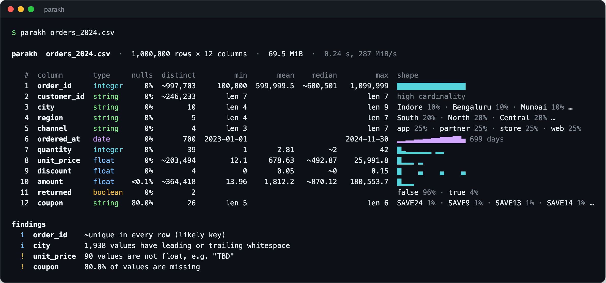

<div align="center">

# parakh

**Profile a CSV of any size in one pass, with a few megabytes of memory.**

Types, nulls, distinct counts, quantiles, histograms, top values and data-quality warnings for every column,
from a single static binary written in Zig.

[](https://samarthjaiswal.github.io/parakh/)
[](https://github.com/SAMARTHJAISWAL/parakh/actions/workflows/ci.yml)
[](https://ziglang.org)
[](LICENSE)



</div>

**[Try it in your browser →](https://samarthjaiswal.github.io/parakh/)** Drop a CSV, TSV or `.gz` file, or run the
built-in 1M-row sample. The page runs this same Zig code compiled to a 256 KB WebAssembly module, and a Web Worker
streams your file to it in slices, so nothing is uploaded and even multi-gigabyte files stay at a few megabytes of memory.

*Parakh* (परख) is Hindi for "to assess" or "to judge the quality of".

## Why

Before you trust a CSV you want to know what is in it. Which columns are numbers, how many values are
missing, whether `order_id` is really unique, and whether someone typed `TBD` into a price column.
Loading the file into pandas tells you, but it costs the whole file in RAM plus a Python start-up.
`parakh` streams the file once and keeps a fixed-size summary per column, so a 10 GB export
profiles as easily as a 10 KB one.

On a 1,000,000-row, 70 MiB orders file (Apple M3):

|                                                | wall time  | peak memory |
| ---------------------------------------------- | ---------: | ----------: |
| **parakh** (default, all cores)                | **0.24 s** | **9.6 MB**  |
| parakh `-j 1` (single thread)                  | 0.69 s     | 5.9 MB      |
| pandas 3.1 `read_csv` + `describe` + `nunique` + `quantile` | 1.01 s | 568 MB |

Memory doesn't depend on row count: the same command on a 3,000,000-row file peaks at 9.7 MB.

## Features

- **One pass, bounded memory.** Every statistic comes from a streaming algorithm (see
  [How it works](#how-it-works)). Nothing is held per row.
- **Type inference that admits doubt.** Each cell is classified on its own (integer, float, boolean,
  date, datetime, string) and the column takes the majority type. The cells that disagree are
  reported with an example: `90 values are not float, e.g. "TBD"`.
- **Data-quality findings.** Candidate keys, constant columns, mostly-empty columns, type anomalies,
  whitespace-padded values, ragged rows, duplicate header names and broken quoting.
- **Exact when it can be, approximate when it must be.** Distinct counts and quantiles are exact up
  to 4,096 values per column, then switch to sketches. Approximate figures are marked with `~`.
- **Real-world CSV.** RFC 4180 quoting with embedded delimiters, newlines and `""` escapes. LF, CRLF
  and bare-CR line endings, a UTF-8 BOM, blank lines, and an auto-sniffed delimiter (`,` `;` tab `|`).
  Transparent **gzip**, detected from the bytes rather than the file name.
- **Parallel, and still deterministic.** One thread parses while worker tasks profile disjoint column
  sets on Zig's new `std.Io`. The output is byte-for-byte identical to the single-threaded run, and a
  test enforces this.
- **Three output formats.** A colour terminal table with sparklines, GitHub Markdown, or JSON for
  `jq` and pipelines.
- **A CI gate.** `--fail-on-warn` exits with status 2 when any warning fires, so a bad export fails
  the build.
- **Runs in the browser too.** The [live demo](https://samarthjaiswal.github.io/parakh/) is the same engine
  compiled to `wasm32-freestanding` with SIMD. A custom `std.Io.Reader` pulls input through `FileReaderSync`
  inside a Web Worker, so the browser streams files exactly the way the CLI does.
- **A single dependency-free binary** for Linux, macOS and Windows on x86-64 and ARM64.
  It is cross-compiled from one machine.

## Quick start

**Download a binary** from [Releases](https://github.com/SAMARTHJAISWAL/parakh/releases), or build from source
with [Zig 0.17.1](https://ziglang.org/download/):

```sh
git clone https://github.com/SAMARTHJAISWAL/parakh
cd parakh
zig build -Doptimize=ReleaseFast
./zig-out/bin/parakh tests/fixtures/messy_orders.csv
```

Put `zig-out/bin/parakh` somewhere on your `PATH`, then:

```sh
parakh sales.csv                       # colour table in the terminal
parakh events.csv.gz                   # gzip is detected automatically
cat export.tsv | parakh                # stdin works too
parakh -f markdown data.csv > PROFILE.md
parakh -f json data.csv | jq '.columns[] | select(.null_ratio > 0.1) | .name'
```

Try it on the bundled messy fixture (BOM, CRLF, quoted commas, an embedded newline, a ragged row):

```text
$ parakh tests/fixtures/messy_orders.csv
parakh  messy_orders.csv  ·  12 rows × 9 columns  ·  751 B

  #  column      type     nulls  distinct         min     mean   median         max  shape
  1  order_id    integer     0%        12       1,001  1,006.5  1,006.5       1,012  ███ ██ ██ ██ ███
  2  customer    string      0%        12       len 9                        len 13  all distinct
  3  region      string      0%         4       len 4                         len 5  North 33% · East 25% · South 25% · West 17%
  4  amount      float     8.3%        11         450  3,333.4  1,600.3      15,000  █▄▃   ▃        ▃
  5  currency    string      0%         1       len 3                         len 3  INR 100%
  6  ordered_at  date        0%        11  2024-01-03                    2024-01-22  █▄ ▄ ▄▄▄  ▄ ▄ ▄▄ 19 days
  7  shipped     boolean     0%         4                                            true 58% · false 25% · no 8% · yes 8%
  8  notes       string   66.7%         4       len 5                        len 25  all distinct
  9  column_9    string   91.7%         1       len 5                         len 5  field 8%

findings
  i  order_id  unique in every row (candidate key)
  i  customer  unique in every row (candidate key)
  i  region    1 value has leading or trailing whitespace
  !  amount    1 value is not float, e.g. "pending"
  i  currency  constant: every value is "INR"
  !  notes     66.7% of values are missing
  !  column_9  91.7% of values are missing
  i  column_9  constant: every value is "field"
  !  (file)    1 row has a different number of fields than the header
```

## Usage

```text
parakh [options] [FILE]

  -f, --format <fmt>     table (default), markdown, json
  -d, --delimiter <c>    field delimiter: a character or 'tab' (default: sniffed)
      --no-header        first row is data; columns are named column_1, column_2, ...
  -n, --top <N>          top values kept per column (default 5, max 64)
  -j, --threads <N>      worker threads (default: cores - 1; 1 = single-threaded)
      --color <when>     auto (default), always, never. NO_COLOR is respected.
      --fail-on-warn     exit with status 2 if any warning is found (for CI gates)
  -h, --help / -V, --version
```

Exit codes: `0` success, `1` unreadable input, `2` warnings found with `--fail-on-warn`, `64` bad arguments.

### Gate a data pipeline in CI

```yaml
- name: Profile the nightly export
  run: |
    parakh -f markdown export.csv >> "$GITHUB_STEP_SUMMARY"
    parakh --fail-on-warn export.csv
```

### JSON schema (abridged)

```jsonc
{
  "source": "orders_2024.csv", "delimiter": ",", "rows": 1000000, "column_count": 12, "bytes": 72890527,
  "ragged_rows": 0, "malformed_fields": 0,
  "columns": [ /* … */ {
    "index": 7, "name": "unit_price", "type": "float",
    "count": 1000000, "nulls": 0, "null_ratio": 0,
    "distinct": 203494, "distinct_exact": false,
    "anomalies": 90, "anomaly_example": "TBD", "padded": 0,
    "numeric": { "min": 12.1, "max": 25991.79, "mean": 678.63, "stddev": 641.77, "sum": 678571754.51,
                 "p05": 132.69, "p25": 286.55, "p50": 492.87, "p75": 847.45, "p95": 1844.98,
                 "quantiles_exact": false, "histogram": [ /* 16 bucket counts */ ] },
    "temporal": null,
    "text": { "min_length": 3, "max_length": 8, "mean_length": 6.07 },
    "top_values": [ /* up to --top entries: { "value": …, "count": … } */ ], "top_exact": false
  } /* … */ ],
  "findings": [{ "severity": "warn", "column": "unit_price", "message": "90 values are not float, e.g. \"TBD\"" }]
}
```

## How it works

```
 bytes ─▶ gunzip? ─▶ CSV state machine ─▶ batch of rows ─┬─▶ worker 1: columns 0, 3, 6 …
          (magic     (SIMD scan for       (double-        ├─▶ worker 2: columns 1, 4, 7 …
           bytes)     , " \r \n)           buffered)      └─▶ worker 3: columns 2, 5, 8 …
                                                                   │
                                     per-column sketches ◀─────────┘
                                                │
                                   Report ─▶ table │ markdown │ json
```

Each column keeps a fixed set of streaming summaries:

| Question                     | Algorithm                                                                                   | Memory per column | Error                                        |
| ---------------------------- | ------------------------------------------------------------------------------------------- | ----------------- | -------------------------------------------- |
| How many distinct values?    | Exact hash set up to 4,096, then **HyperLogLog** (p = 16) with linear-counting correction    | 64 KiB            | exact, then ≈0.41 % standard error           |
| Median, p05 … p95, histogram | Exact buffer up to 4,096, then **KLL sketch** (k = 512, merge-based compaction)               | ≈ 16 KiB (~2,000 values, any stream length) | exact, then ≈0.3 % worst-case rank error |
| Most common values?          | **Misra-Gries** heavy hitters with DataSketches-style purge-by-median, fixed key slots        | ≈ 8 KiB           | exact until the first purge, then bounded undercount |
| Mean and standard deviation  | **Welford's** online algorithm                                                              | 24 B              | exact (numerically stable)                   |
| Type of each cell            | Hand-written classifiers: Clinger's fast path for decimals, calendar-checked ISO dates       | 0                 | exact                                        |

Some details worth knowing:

- **The CSV parser** works on the reader's buffer directly. Runs of plain bytes are found 16 at a
  time with `@Vector` compares and copied in one go; the per-byte state machine only runs on
  delimiters, quotes and line ends. Malformed quoting is read leniently and counted rather than
  rejected.
- **KLL instead of P².** An early version used the P² estimator. It interpolates between markers,
  so on an integer column with heavy ties it reported a median of `1.64` where the truth was `2`.
  KLL only returns values it has actually seen. It also feeds the histograms, so there is one
  sketch per column instead of two.
- **Hash-map tombstones.** The first heavy-hitters version spent 70 % of runtime probing a hash map
  that churn had filled with tombstones. Rebuilding the index after each purge took throughput from
  21 MiB/s to 83 MiB/s.
- **Parallelism without nondeterminism.** A batch's columns are split across workers, each column is
  owned by exactly one worker, and batches run in order. Each KLL sketch has a fixed seed. Thread
  count therefore cannot change the output, and `profile.zig` has a test asserting identical JSON
  for the serial and parallel paths, including ragged rows and late-appearing columns.

Measured on the 1M-row benchmark against exact answers computed in Python: every estimated distinct
count was within 0.65 % of the truth, and the KLL median and p95 landed within 0.001 of the target
rank. Generate the same data with `python3 bench/generate.py 1000000 > orders.csv`.

## Use it as a Zig library

```zig
const parakh = @import("parakh");

var reader: std.Io.Reader = .fixed(csv_bytes);
const report = try parakh.profileReader(gpa, arena, &reader, .{ .io = io });
try parakh.render.write(stdout, report, .json, .{});
```

The sketches are standalone modules too: `parakh.sketch.hll`, `.kll`, `.topk`, `.quantiles`.

## Development

```sh
zig build test --summary all      # 50+ unit and end-to-end tests
zig build -Doptimize=ReleaseFast  # binary in zig-out/bin
zig build run -- data.csv         # build and run
zig build wasm                    # browser demo in zig-out/web (serve it with any static server)
```

The `tests/fixtures/` directory holds deliberately ugly CSVs: a BOM, CRLF, quoted delimiters, an
embedded newline, doubled quotes, a ragged row, a semicolon-delimited file and a headerless TSV.
CI runs the suite on Linux, macOS and Windows, cross-compiles all six release targets, and profiles a
1M-row file on every push.

## Limitations

- Dates are recognised in ISO-8601 form (`2024-01-31`, `2024/01/31`, `2024-01-31T09:30:00Z`).
  Locale formats such as `31/01/2024` are profiled as strings.
- Numbers use `.` as the decimal separator and optional `,` thousands groups. `1.234,5` stays a string.
- Lengths are counted in Unicode code points, not grapheme clusters.

## License

[MIT](LICENSE)
